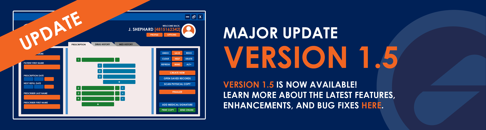

# **PRODUCT OVERVIEW**
---

The **Daley Dose** application streamlines the prescription-writing process for healthcare professionals.

Its user-friendly interface and powerful features enable users to create prescriptions accurately, efficiently, and securely. The application also offers extended capabilities, including communication with patients, pharmacies, and online stores to support accurate and timely medication distribution. These features help ensure that patients receive their medications promptly and conveniently.

## **WHAT'S NEW**
---

## **FEATURED CONTENT**
---
- [**Access the Help Files**](/daleydose/help-files)  
&#x20; View documentation containing detailed window definitions and step-by-step user guides.

<!--
- [**Customer Release Notes**](/daleydose/release-note-customer-1.5)  
&#x20;   Discover new features, application improvements, and changes.
-->

- [**Version 1.5 Release Notes**](/daleydose/release-note-internal-1.5)  
&#x20;   Explore new features, enhancements, and bug fixes from the latest update.

<!--
- [**Version History**](/daleydose/release-note-version-history)  
&#x20;   View a complete archive of past releases, including feature additions, changes, and resolved issues.
-->

## **FUNDAMENTALS**
---

- [**About Daley Dose**](/daleydose/about-daley-dose)  
  Explore what makes Daley Dose a reliable and efficient tool for healthcare professionals. Learn how its features streamline prescribing, improve patient care, and simplify workflow management.

- [**About User Roles**](/daleydose/about-user-roles)  
  Learn how Daley Dose user roles define access and capabilities within the application. Discover which roles suit your workflow and how responsibilities are distributed among Administrators, Support, Prescribers, Pharmacists, and Spectators.

- [**About Prescription Restrictions**](/daleydose/about-prescription-restrictions)  
  Understand how prescription restrictions determine which medications a Prescriber can order in Daley Dose. Learn how Administrators apply limits, view current restrictions, and ensure prescriptions comply with hospital guidelines.

  

  <button
    type="button"
    aria-label="Play Daley Dose introduction video"
    style="position:absolute; top:50%; left:50%; transform:translate(-50%,-50%); background:rgba(0,0,0,0.75); color:white; border:0; border-radius:50%; width:76px; height:76px; font-size:32px; cursor:pointer;"
    onclick="document.getElementById('daley-dose-video').innerHTML='<iframe src=&quot;https://www.youtube.com/embed/cMtAAYXDdLo?autoplay=1&quot; title=&quot;Daley Dose intro&quot; frameborder=&quot;0&quot; allow=&quot;accelerometer; autoplay; clipboard-write; encrypted-media; gyroscope; picture-in-picture; web-share&quot; allowfullscreen style=&quot;position:absolute; top:0; left:0; width:100%; height:100%;&quot;></iframe>';"
  >▶</button>

<!--
## **PHARMACY TOOLS**
---
- [**The Pharmacist's View**](/daleydose/window-pharmacy)  
&#x20; Explore the pharmacist-facing version of the Daley Dose application.

-->

## **ADDITIONAL LINKS**
---
- [**HireDale.com**](https://hiredale.github.io)  
  The main hub for my portfolio, technical documentation, and professional resources.

- [**LinkedIn Profile**](https://www.linkedin.com/in/dalealbertgaddi/)  
  My professional profile, including work experience, qualifications, and career background.

<!--  --> 

