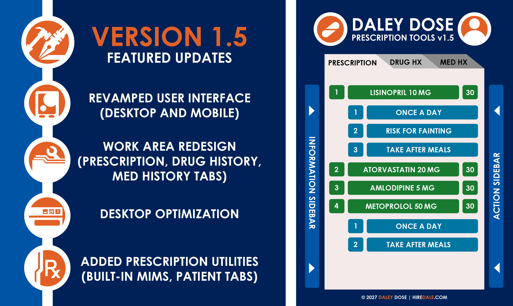

# **DALEY DOSE VERSION 1.5 RELEASE NOTES**
---
**RELEASE DATE**: 2025-09-12

We're excited to introduce the latest version of the **Daley Dose** application!

This release introduces a redesigned user interface, improved navigation, and several enhancements to prescription management. These updates make it easier to access patient information, manage prescriptions, and navigate the application.

Note that the latest Daley Dose application requires an active subscription. Visit our website for more information on available subscription plans.

## **NEW FEATURES**
---

**Redesigned user interface** – Explore the redesigned application interface, featuring dedicated **Information** and **Action** sidebars for easier access to frequently used tools. New **Drug History** and **Med History** tabs also provide convenient access to patient prescription and medication records.

## **ENHANCEMENTS**
---

- **Desktop-optimized interface** – Enjoy an improved desktop experience with an interface redesigned specifically for desktop use.

- **Easier prescription creation** – Access the **Add Medication** and **Add Note** buttons directly from the **Prescription** tab.

- **Improved information accessibility** – Find patient, doctor, and prescription date information in the **Information** sidebar.

- **Simplified patient information entry** – Enter patient names using separate **First Name** and **Last Name** fields.

- **Organized sidebar actions** – Access the **Add Alternative** and **Add Medical Signature** buttons from the **Action** sidebar.

- **Centralized application actions** – Find the **Create New**, **Scan**, **Send**, and **Print** buttons in one convenient location.

- **Clearer action labels** – The **Scan** and **Send** buttons have been renamed to **Scan Physical Copy** and **Send Online**, respectively, to better describe their functions.

- **Improved workspace navigation** – Access the **Prescription** and **Medical History** areas directly from the redesigned work area.

- **Updated terminology** – The **Prescription Pad** area is now called the **Prescription** tab.

## **BUG FIXES**
---

- Improved prescription validation to address an issue involving alternative medication selection.

- Corrected medication recommendation behavior for certain diagnoses.

## **SEE ALSO**
---
- [**Access the Help Files**](/daleydose/help-files)
- [**Version History**](/daleydose/release-note-version-history)
