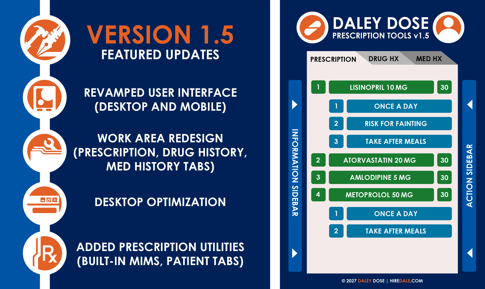

# **DALEY DOSE VERSION 1.5 RELEASE NOTES**
---
**RELEASE DATE**: 2025-09-12

We are excited to introduce the latest version of the **Daley Dose** application!

This release features a major overhaul of the application's user interface and functionality. It also includes several updates to the medication database, cloud coverage, and new prescription features to enhance your experience.

Note that the latest Daley Dose application requires an active subscription.

## **NEW FEATURES**
---

- **DD-2011/2012/2013/2014/2015/2017/2020**
  - Redesigned layout with new **Information** and **Action** sidebars for faster access to tools.
  - Added the **Undo**, **Redo**, **Save**, **Clear**, **Help**, **Delete**, **Refresh**, **MIMS**, and **Finalize** buttons.
  - Added the **Drug History** and **Med History** tabs for quick access to patient prescription and medication records.

## **ENHANCEMENTS**
---

- **DD-2016**
  Rebuilt the entire interface for desktop use, moving toward a browser-based application.

- **DD-2018/2019**
  Moved the **Add Medication** and **Add Note** buttons from the sidebar to the **Prescription** tab for faster prescription creation.

- **DD-2021/2022/2023**
  - Moved the **Patient**, **Doctor**, and **Prescription Date** fields to the **Information** sidebar.
  - Updated the work area to provide direct access to both **Prescription** and **Medical History**.
  - Renamed the **Prescription Pad** area to the **Prescription** tab.

- **DD-2024**
  Split the **Patient Name** field into **First Name** and **Last Name** fields to match the **Doctor** field format.

- **DD-2026/2027**
  Moved the **Add Alternative** and **Add Medical Signature** buttons to the **Action** sidebar.

- **DD-2029**
  Moved the **Create New**, **Scan**, **Send**, and **Print** buttons to the **Action** sidebar.

- **DD-2030/2031**
  Renamed **Scan** to **Scan Physical Copy** and **Send** to **Send Online** for clarity.

## **BUG FIXES**
---

- **DD-2000**
  Fixed an issue where adding Vicodin as an alternative bypassed restrictions and diagnostic checks.

- **DD-2001**
  Corrected a rare bug allowing Schedule II narcotics for rhinovirus diagnoses.

- **DD-2004**
  Removed incorrect recommendation of Garlic Bread as a prophylactic antibiotic.

- **DD-2005**
  Corrected classification of Coffee as an FDA-approved cardiac stimulant.

- **DD-2008**
  Removed invalid prescription option for Narcan as a cure for “World of Warcraft addiction.”

- **DD-2010**
  Fixed an issue allowing prescription of 100,000 pseudoephedrine tablets for rhinovirus.

## **SEE ALSO**
---
- [**Access the Help Files**](/daleydose/help-files)
- [**Version History**](/daleydose/release-note-version-history)
