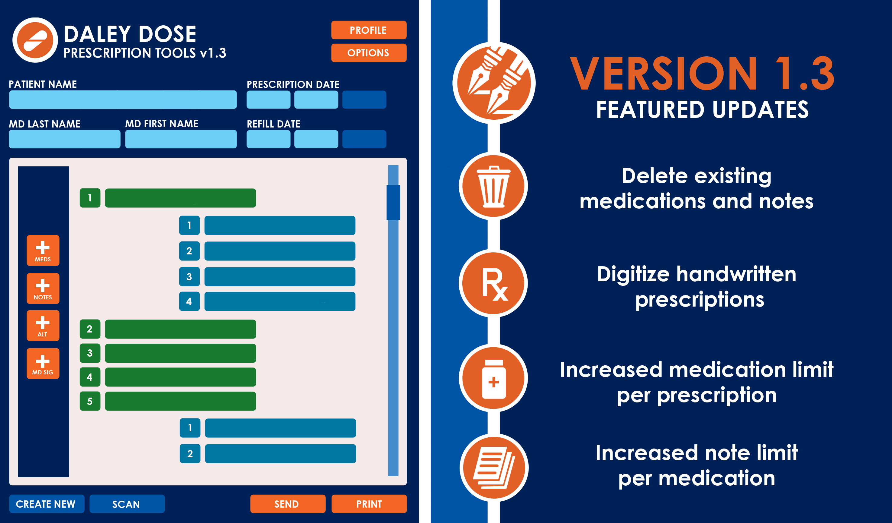
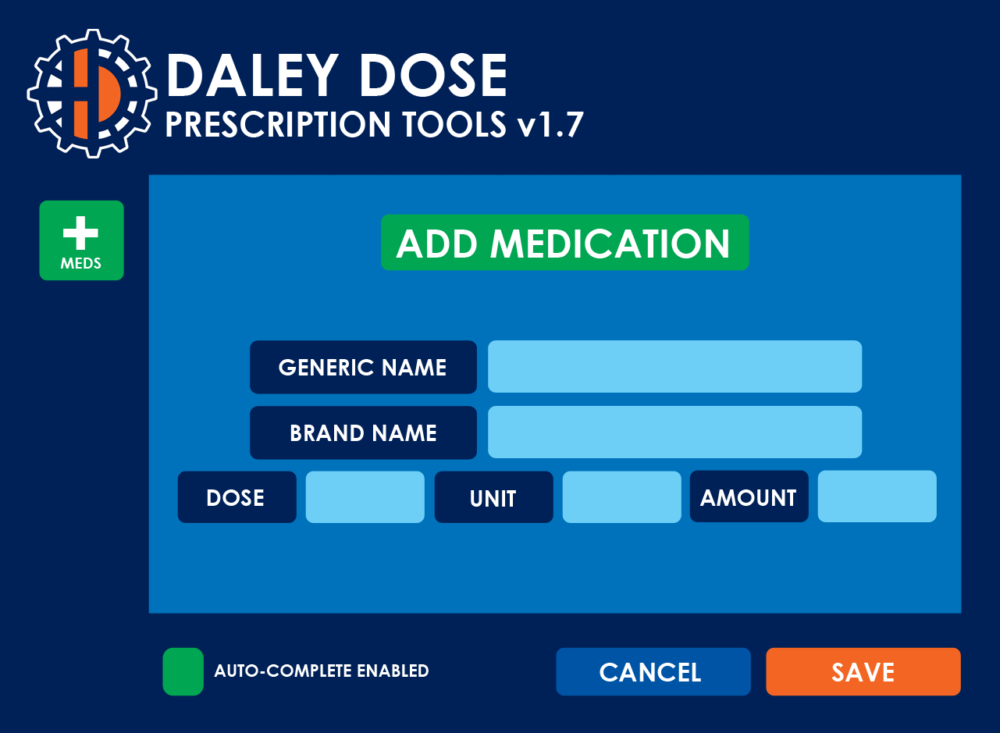
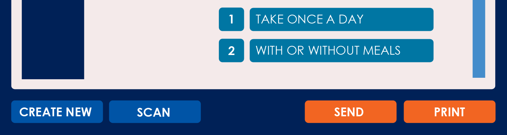

# **DALEY DOSE UPDATE HISTORY**
---
This page provides a complete record of updates to the Daley Dose application, organized by release.  

Each version lists updates under three categories:

- **New Features** – Capabilities introduced for the first time in that release.
- **Enhancements** – Improvements to existing functionality, performance, or usability.
- **Bug Fixes** – Corrections to defects, errors, or unexpected behaviors.

## **VERSION 1.3**
---

**RELEASE DATE**: 2024-09-15

---

This release introduces auto-complete functionality, note and medication deletion, handwritten prescription scanning, expanded user roles, increased prescription and note limits, and critical bug fixes.

### **NEW FEATURES**
---
The following features were introduced in version 1.3 of the Daley Dose application:

---

#### **AUTO-COMPLETE MEDICATION NAMES**

**PURPOSE**  
To help users enter medication details more efficiently by providing generic and brand-name suggestions.

**CHANGES**

- Added the **Auto-Complete Status** field to the **Add Medication** window with the following indicators:  

  - **Green**: Auto-complete is enabled.
  - **Red**: Auto-complete is disabled.
  - **Purple**: Auto-complete is disabled for all accounts by an administrator.

<!-- -->

- Enabled this feature by default, with the option to turn it off in the **Options** window.

**REFERENCE NUMBERS**  
DD-401/402/403

<!-- -->

---

#### **DELETE EXISTING MEDICATIONS AND NOTES**

**PURPOSE**  
To allow users to remove medications and notes directly from the current prescription.

**CHANGES**  

- Added the **Medication Number** and **Note Number** fields.
- Enabled users to delete the corresponding medication or note by double-clicking its respective field.
- Added the confirmation message **Are you sure you want to delete this from the prescription?** before deletion.
- Deleted items cannot be restored and must be manually re-entered using the **+ Med** or **+ Note** buttons.
- Deletion is not available for transcribed prescriptions.

**REFERENCE NUMBERS**  
DD-404/405/406

---

#### **DIGITIZE HANDWRITTEN PRESCRIPTIONS**

**PURPOSE**  
To allow users to convert handwritten prescriptions into digital prescriptions using a webcam or smartphone.

**CHANGES**  

- Added the **Scan** button for desktop and mobile devices.
- The desktop version requires a connected webcam, while the mobile version always displays the button.
- Scanned prescriptions cannot be edited.

**REFERENCE NUMBERS**  
DD-407/408

---

#### **ADDITIONAL USER PROFILE ROLES**

**PURPOSE**  
To allow administrators to assign user roles and control access to application functions based on assigned roles.

**CHANGES**
- Added the **Role** field to the **User Profile** window with the following options:  

 - **Administrator**
 - **Support**
 - **Prescriber**
 - **Pharmacist**
 - **Spectator**

<!-- -->

- Restricted role assignment and editing to users with the **Administrator** or **Support** role.
- Restricted medication prescribing to users with the **Prescriber** role.

**REFERENCE NUMBERS**  
DD-409/410

### **ENHANCEMENTS**
---
The following enhancements were introduced in version 1.3 of the Daley Dose application:

---

#### **INCREASED MEDICATION LIMIT PER PRESCRIPTION**

**PURPOSE**  
To allow users to add more medications to a single prescription.

**CHANGE**  
Increased the medication limit per prescription from 3 to 5.

**REFERENCE NUMBER**  
DD-411

---

#### **INCREASED NOTE LIMIT PER MEDICATION**

**PURPOSE**  
To allow users to add more notes per medication and include additional information in each note.

**CHANGES**  

- Increased the note limit per medication from 3 to 5.
- Increased the note length limit from 10 words to 25 words.
- Added the error message **Note Too Long** when a note exceeds 25 words.

**REFERENCE NUMBERS**  
DD-412/413

### **BUG FIXES**
---

The following bugs and issues were addressed in version 1.3 of the Daley Dose application:

---

#### **MEDICAL DATABASE ISSUES**

---

- **DD-414**  
  Resolved a known issue where the application incorrectly recognized **Potion of Minor Healing** as the generic name for cough medication.

<!-- -->

- **DD-415**  
  Resolved a known issue where the application incorrectly recognized **Thoughts and Prayers** as a type of chemotherapy medication.

<!-- -->

- **DD-416**  

  - Fixed a rare bug where the application sent multiple copies of the same Schedule II narcotics prescription to different pharmacy outlets when the **Send** button was clicked.  
  - The application now assigns a serial number to each prescription to prevent duplicates.

<!-- -->

- **DD-417**  
  Resolved an issue where the application incorrectly approved prescriptions for Schedule II narcotics for minor pain diagnoses.

<!-- -->

- **DD-418**  
  Fixed a common bug that duplicated the **Doctor** title when applying an **MD Signature**.

<!-- -->

- **DD-419/420/421**  
  Fixed a rare bug that incorrectly classified Schedule II narcotics as over-the-counter (OTC) medication.

<!-- -->

- **DD-422/423/424**

  - Resolved an issue where the application erased all progress when the internet connection was lost during prescription creation.  
  - The application now saves current progress, allowing you to continue building the prescription.  
  - An active internet connection is still required to finalize, send, or print the draft.

## **VERSION 1.2**
---

**RELEASE DATE**: 2024-03-20

---

This release introduces the ability to add alternative medications, apply prescription restrictions, and includes critical bug fixes to improve reliability and patient safety.

### **NEW FEATURES**
---
The following features were introduced in version 1.2 of the Daley Dose application:

---

#### **ADD ALTERNATIVE MEDICATION**

**PURPOSE**  
To allow users to specify an alternative medication when the originally prescribed medication is unavailable at the pharmacy, avoiding the need for patients to return for a refill.

**CHANGES**  

- Added the **+ Alt** button, which opens the **Add Alternative** window.
- Enabled users to enter a different brand or generic name for the selected medication.
- Configured the application to use the alternative when the pharmacy reports that the original medication is out of stock at the time of the patient's refill.
- Available on all platforms.

**REFERENCE NUMBERS**  
DD-301/302

---

#### **ADD PRESCRIPTION RESTRICTIONS**

**PURPOSE**  
To allow administrators to control which medication schedules Prescriber users are authorized to prescribe.

**CHANGES**  

- Added the **Prescription Restriction** drop-down list under **Home > Profile** with the following options:  

  - **No Restrictions**
  - **Restrict Schedule II**
  - **Restrict Schedule II and III**
  - **Restrict Schedule II, III, and IV**
  - **Only OTCs**

<!-- -->

- Restricted configuration of this option to Administrators for Prescriber users.
- Advised users to contact their company's technical support team for more information.
- Available on all platforms.

**REFERENCE NUMBER**  
DD-303

### **BUG FIXES**
---

The following bugs and issues were addressed in version 1.2 of the Daley Dose application:

---

- **DD-304**  
  Resolved an issue where the application incorrectly recognized *Just Be Happy* as an antidepressant medication.

<!-- -->

- **DD-305**  
  Fixed a critical issue where pharmacies received notifications for all patients, causing repeated alerts until devices were turned off.

<!-- -->

- **DD-306**  
  Fixed an authentication issue that required users to re-enter their information every minute.

<!-- -->

- **DD-307**  
  Resolved a bug that disabled prescription features on phones older than five years.

---

## **VERSION 1.1**
---

**RELEASE DATE**: 2024-03-16

This release introduces the ability to continue writing a prescription from a previous session and includes critical bug fixes to improve stability and prevent unintended QR code behavior.

### **NEW FEATURES**
---

#### **CONTINUE PREVIOUS SESSION**

**PURPOSE**  
To allow users to resume writing a prescription from where they left off in a previous session.

**CHANGES**  

- Modified Daley Dose to save the last unfinalized session before the application is closed.
- Enabled users to view and continue from the last saved instance of a previous prescription, if available, when starting the application.
- Enabled this feature by default, with the option to disable it in the **Options** window.
- Available on all platforms.

**REFERENCE NUMBERS**  
DD-201/202

### **BUG FIXES**
---

The following bugs and issues were addressed in version 1.1 of the Daley Dose application:

---

- **DD-203**  
  Fixed a minor bug that closed the application when it idled for more than 30 seconds.

<!-- -->

- **DD-204**  
  Resolved an extremely rare bug where the finalized prescription's QR code sent pharmacies a link to the **Rickroll** YouTube page.

<!-- -->

- **DD-205**  
  Resolved an extremely rare bug where the finalized prescription's QR code sent pharmacies the entire opening monologue to the **Bee Movie**, causing devices to crash due to the volume of text.
  
<!-- -->

---
## **SEE ALSO**
---
- [**Version 1.5 Release Notes**](/daleydose/release-note-internal-1.5)
- [**Access the Help Files**](/daleydose/help-files)

