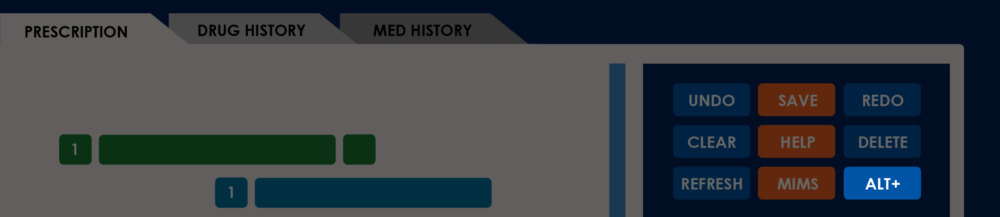
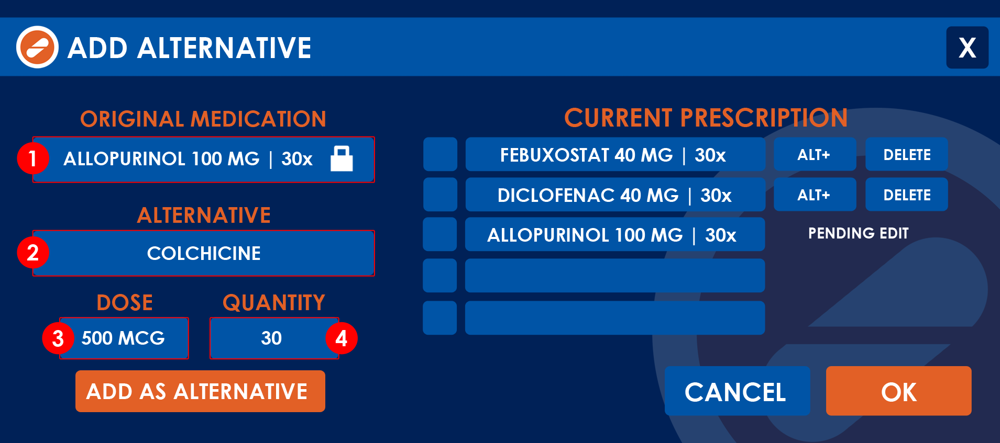
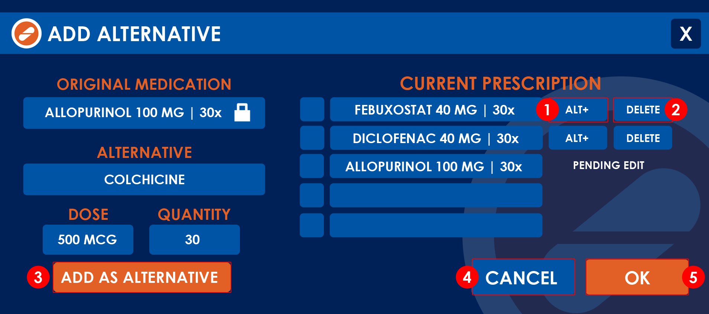

# **ADD ALTERNATIVE WINDOW**

In the **Add Alternative** window, you can add an alternative option for the pharmacy in case the prescribed medication is not available.  

To view this window: **Prescription** tab > Select the medication you want to add an alternative option for > **Add Alternative** (**Alt +**)
  

## **NOTES**
---
- Your device must be connected to the internet to add medications. The Daley Dose database cross‑checks the entered patient’s diagnoses with the medications you are allowed to prescribe.  
- The application prevents you from adding alternative medication when the prescription is empty.  
- You cannot set the same medication as its alternative option.  
- The application auto‑completes generic and brand name suggestions for each medication by default. You can turn off this feature in the options.  

## **INTERFACE DETAILS**
---

The elements in this window are divided into two categories: **Fields** and **Buttons**.

### **FIELDS**
The following table describes the fields in the **Add Alternative** window:

| # | FIELD | DEFINITION |
|---|---|---|
| 1 | **ORIGINAL MEDICATION** | Displays the original medication name and dose. This is a read-only field and serves as a reference when creating the alternative entry.  **Note:** This field reminds you which medication you are creating the alternative for. To select another medication, return to the **Prescription** tab first. |
| 2 | **ALTERNATIVE** | Enter the alternative medication’s brand or generic name. |
| 3 | **DOSE** | Enter the medication’s dosage.  **Note:** The application disables this field when the entered medication does not include dosage instructions. |
| 4 | **QUANTITY** | Enter the medication quantity for the prescription. |

### **BUTTONS**
The following table describes the buttons available in the **Add Alternative** window:

| # | BUTTON | DEFINITION |
|---|---|---|
| 1 | **ALT+** | Click to add an alternative to the medication. |
| 2 | **DELETE** | Click to delete the current entry from the prescription. |
| 3 | **ADD AS ALTERNATIVE** | Click to add the entered medication to the prescription. |
| 4 | **CANCEL** | Click to close the **Add Medication** window without adding the entered information to the prescription.  **Note:** When clicked, the application displays the confirmation message **"Are you sure you want to close this window without adding the medication?"** before closing. |
| 5 | **OK** | Click to close the **Add Alternative** window and add the entered information to the prescription.  **Note:** This button is disabled if any of the following fields are empty: **Generic Name**, **Dose**, or **Amount**. |

## **RELATED TOPICS**
---
- You must have the **Prescriber** role to view this window. See [**User Roles**](/daleydose/about-user-roles) for more information.  
- An **Administrator** or **Support** user can impose or remove a prescription restriction on a **Prescriber**. See [**Prescription Restrictions**](/daleydose/about-prescription-restrictions) for more information.

## **SEE ALSO**
---
- [**How to add medications to a prescription**](/daleydose/prescription-add-meds)  
- [**How to delete medications from a prescription**](/daleydose/prescription-delete-meds) 
