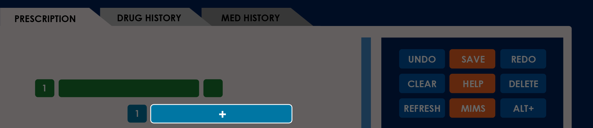
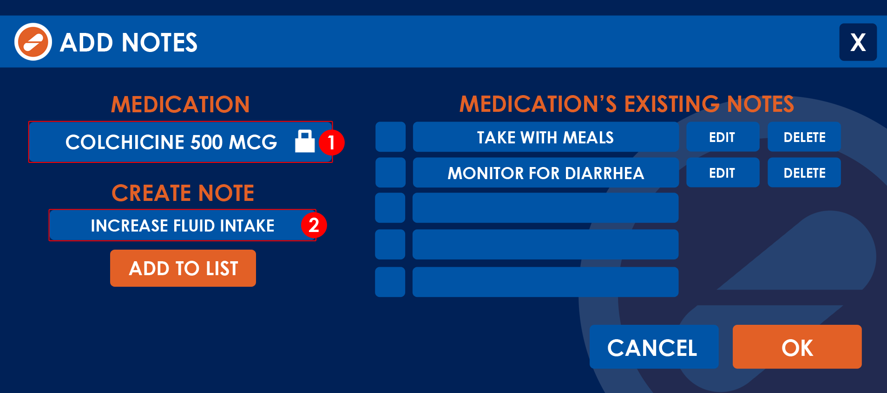
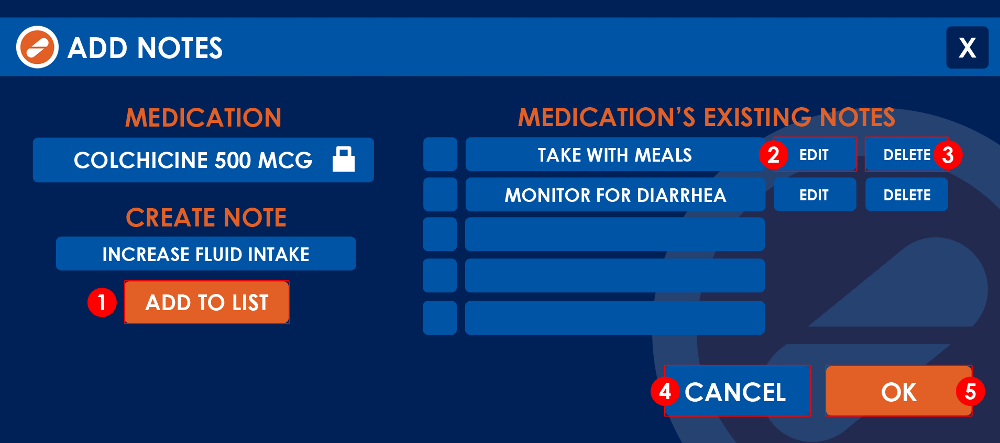

# **ADD NOTES WINDOW**

In the **Add Notes** window, you can add notes to the prescribed medication.  

Pharmacies print a copy of the medications and their associated notes when the patient comes in to fill the prescription.  

**Suggested notes include:**  
- Number of doses per day  
- Whether the dose should be taken with or without meals  
- Special instructions before or after taking the dose  
- Whether the medication requires test results before taking  

To view this window: **Prescription** tab > Under the medication entry you want to add a note > **Add Note** (blue **Plus**)

 

## **NOTES**
---
- The application prevents you from adding notes when the **Patient Name** fields are empty.
- The application prevents you from adding notes when there are no medications added to the current prescription.
- You can add up to 5 notes per medication.

## **INTERFACE DETAILS**
---
The elements in this window are divided into two categories: **Fields** and **Buttons**.

## **FIELDS**
The following table describes the fields in the **Add Notes** window:

 

| # | **FIELD** | **DEFINITION** |
|---|-----------|----------------|
| 1 | **MEDICATION** | Displays the selected medication.  **Note:** This field is read-only. It serves to remind you which medication you are creating notes for. To select another medication for notes, you must return to the **Prescription** tab first. |
| 2 | **CREATE NOTE** | Displays a blank note. Click to edit its contents.  **Note:** You can add up to 5 notes per medication. |

## **BUTTONS**
The following table describes the buttons in the **Add Notes** window:

 

| # | **BUTTON** | **DEFINITION** |
|---|------------|----------------|
| 1 | **ADD TO LIST** | Click to add the created note to the prescription.  **Notes:** • You can add up to 25 words per note and 5 notes per medication. • The application displays the error message **"Note Too Long"** when you attempt to add more than 25 words in a single note. |
| 2 | **EDIT** | Click to edit the selected note. |
| 3 | **DELETE** | Click to delete the selected note. |
| 4 | **CANCEL** | Click to close the **Add Notes** window without adding the currently entered information to the prescription.  **Note:** When you click this button, the application displays the confirmation message **"Are you sure you want to close this window without adding the notes?"** before closing. |
| 5 | **OK** | Click to close the **Add Notes** window and add the currently entered information to the prescription. |

## **RELATED TOPICS**
---
- You must have the **Prescriber** role to view this window. See [**User Roles**](/daleydose/about-user-roles) for more information.  
- An **Administrator** or **Support** user can impose or remove a prescription restriction on a **Prescriber**. See [**Prescription Restrictions**](/daleydose/about-prescription-restrictions) for more information.

## **SEE ALSO**
---
- [**How to add, edit, and delete medication notes**](/daleydose/prescription-manage)  
- [**How to finalize and send out a prescription**](/daleydose/prescription-finalize)

