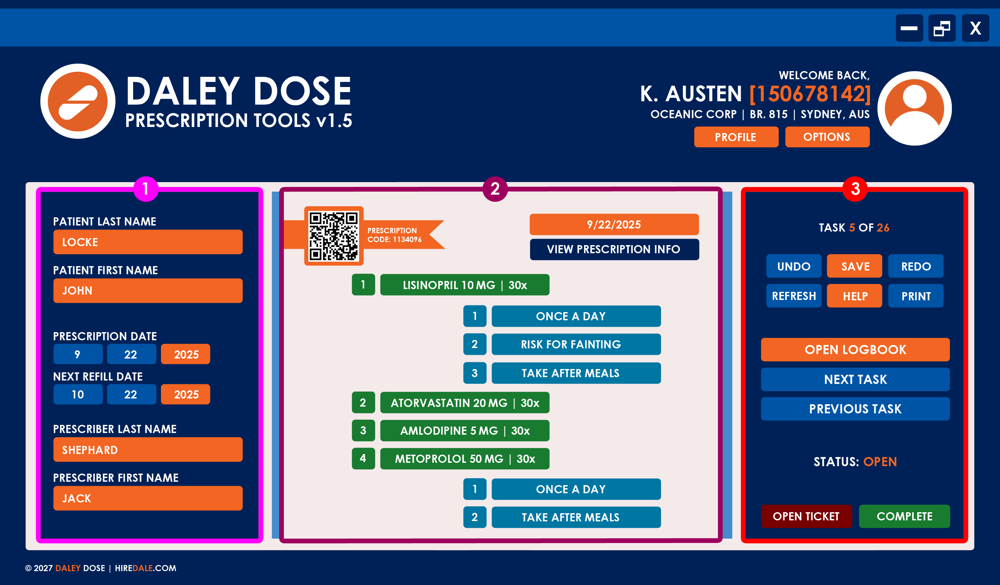
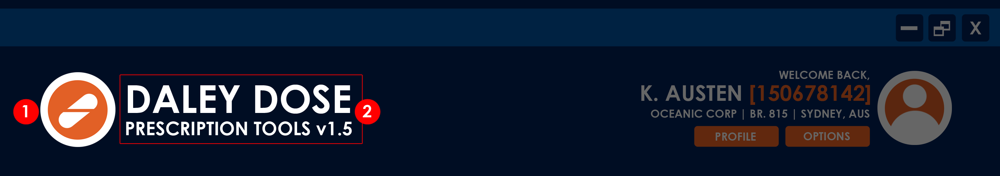
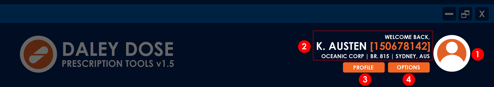
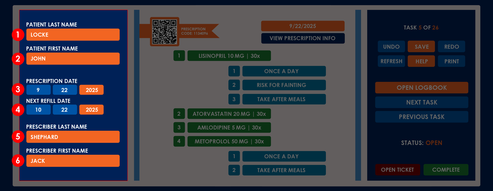
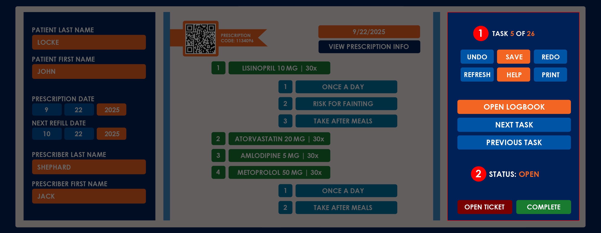
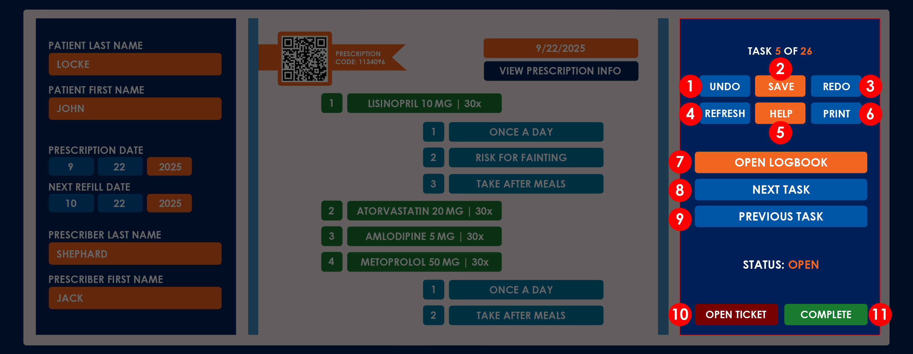
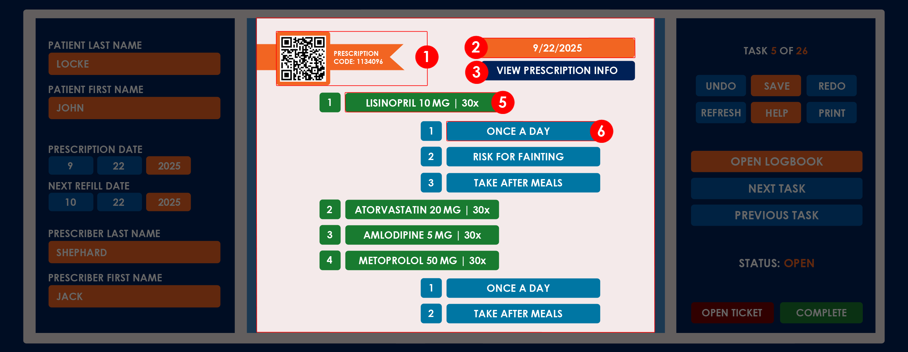

# **PHARMACY WINDOW**
---

In the **Pharmacy** window, you can create medical prescriptions for your patients. Each prescription can include up to 5 medications. You can also scan physical prescriptions and convert them into a digital version.

- To create a new prescription, click **Create New** in the **Action Sidebar**.
- To open a previously saved prescription drafts, click **Open Saved Records**.
- By default, after logging into the application, the **Home** window loads the last saved instance of a previous prescription draft (if any), enabling you to continue where you left off. You can disable this feature in the options.

## **NOTES**
---
- Access to the **Daley Dose** application requires an active subscription.  
- Your device must be connected to the internet to send digital prescriptions.

## **INTERFACE DETAILS**
---
  

The **Home** window is composed of the following sections:

| # | **SECTION** | **DEFINITION** |
|---|-------------|----------------|
| 1 | **TITLE SECTION** | Displays the application title and version number. |
| 2 | **PROFILE SECTION** | Displays the name of the prescriber currently logged into the application. |
| 3 | **INFORMATION SIDEBAR** | Displays fields related to patient information. |
| 4 | **ACTION SIDEBAR** | Displays options used during the prescription process. |
| 5 | **WORK AREA** | Displays the current prescription draft. |

Most of the interface remains the same throughout the prescription‑making process. Only the middle section, referred to as the **Work Area**, changes depending on the current window or tab accessed.

## **TITLE SECTION**
---
The **Title Section** is located in the top‑left corner of the screen. 

It contains the **Daley Dose** name, logo, and version number.

The following table describes the buttons in the **Title Section**:

| # | **BUTTONS** | **DEFINITION** |
|---|-------------|----------------|
| 1 | **DALEY DOSE ICON** | Displays the current **Daley Dose** icon. Click the icon to refresh the application's connection to the database. |
| 2 | **BRANDING AREA** | Displays the **Daley Dose** branding and the current application version. Click the **Daley Dose** title to view the **System Information** pop-up window.  This window displays detailed information about the application, including its complete version number, release date, and a list of developer notes included in the build. |

## **PROFILE SECTION**
---
The **Profile Section** is located in the top‑right corner of the screen.

You can view your profile information and access in‑app settings here. This section also displays a greeting during an active session, showing the current active **Prescriber** and their system‑assigned ID.  

The following table describes the buttons in the **Profile Section**:

| # | **BUTTONS** | **DEFINITION** |
|---|-------------|----------------|
| 1 | **PROFILE ICON** | Click to view the **Profile Summary** pop-up window.  The application displays detailed information about the user currently logged in, such as their professional license number, specialization, and any prescription restrictions, as well as their duration. |
| 2 | **PROFILE DETAILS** | Displays the prescriber's name and account number. |
| 3 | **PROFILE** | Click to view the active profile’s information, role, prescription restrictions, form templates, and saved security settings.  When you select this button, the application opens the profile settings. |
| 4 | **OPTIONS** | Click to view the application’s options. |

## **INFORMATION SIDEBAR**
---
The **Information Sidebar** is located on the left side of the screen.  

It displays details about the patient, the prescribing doctor, and the current prescription. You cannot add medications to the current prescription while these fields are empty.  

The following table describes the fields in the **Information Sidebar**:

| # | **FIELDS** | **DEFINITION** |
|---|------------|----------------|
| 1 | **PATIENT LAST NAME** | Displays the patient’s last name. Select to enter or edit the current patient’s name.  **Notes:** • The application prevents adding medications and notes when the **Patient Name** fields are empty. • Entering a **Patient Last Name** restricts options for **Patient First Names** to those with an existing record in the database. |
| 2 | **PATIENT FIRST NAME** | Displays the patient’s first name. Select to enter or edit the current patient’s name. |
| 3 | **PRESCRIPTION DATE** | Displays the prescription’s issue date. Select to enter or edit the current prescription date.  **Note:** The application displays the date in [MM/DD/YYYY] format. |
| 4 | **NEXT REFILL DATE** | Displays the prescription’s scheduled refill date. Select to enter or edit the current scheduled refill date.  **Note:** The application displays the date in [MM/DD/YYYY] format. |
| 5 | **PRESCRIBER LAST NAME** | Displays the prescribing user’s last name.  **Note:** This is a read‑only field. The prescriber information is based on the current user logged into the application. |
| 6 | **PRESCRIBER FIRST NAME** | Displays the prescribing user’s first name.  **Note:** This is a read‑only field. The prescriber information is based on the current user logged into the application. |

## **ACTION SIDEBAR**
---
The **Action Sidebar** is located on the right side of the screen. It displays the buttons that enable you to work on prescriptions in your task list.

### **FIELDS**
The following table describes the fields in the **Action Sidebar**:

| # | **FIELDS** | **DEFINITION** |
|---|-------------|----------------|
| 1 | **DALEY DOSE ICON** | Displays the current **Daley Dose** icon. Click the icon to refresh the application's connection to the database. |
| 2 | **BRANDING AREA** | Displays the **Daley Dose** branding and the current application version. Click the **Daley Dose** title to view the **System Information** pop-up window.  This window displays detailed information about the application, including its complete version number, release date, and a list of developer notes included in the build. |

### **BUTTONS**

| # | **BUTTONS** | **DEFINITION** |
|---|-------------|----------------|
| 1 | **UNDO** | Click to undo the last action performed in the current prescription. |
| 2 | **SAVE** | Click to save the current prescription. The application automatically displays the saved prescription the next time you log in. You can view a list of saved prescriptions using the **Open** button.  **Note:** Saved prescriptions are removed from the system. |
| 3 | **REDO** | Click to redo the last action undone in the current prescription. |
| 4 | **CLEAR** | Click to clear the current prescription entry’s contents. |
| 5 | **HELP** | Click to access an in-app version of the latest **Daley Dose Help Files**.  **Notes:** • The help files automatically open the entry about the current window. • You can also view the latest version of the help files on the **Daley Dose** website. |
| 6 | **DELETE** | Click to open or close **Delete Mode**, which allows you to mark existing entries in the prescription for deletion.  **Note:** The application displays the confirmation message “**Are you sure you want to delete these from the prescription?**” before removing the selected entries from the list. |
| 7 | **REFRESH** | Click to refresh the contents of the current session to match any saved instances or records in the database. This includes the contents of the patient's **Drug History** and **Medical History** tabs. |
| 8 | **MIMS** | Click to access an in-app version of the latest *Monthly Index of Medical Specialities (MIMS)* digital handbook, the most common drug reference for healthcare professionals.  **Note:** The **MIMS** version is updated along with every **Daley Dose** version. |
| 9 | **ALT+** | Click to add an alternative option for the pharmacy if the prescribed medication is not available.  When you select this button, the application opens the [**Add Alternative** window](/daleydose/window-add-alternative).  **Note:** The application auto-completes generic and brand name suggestions for each medication. You can turn off this feature in the options. |

## **WORK AREA**
---
The **Work Area** is where you create, review, and finalize prescriptions. It occupies the center of the screen.

| # | **FIELDS** | **DEFINITION** |
|---|-------------|----------------|
| 1 | **DALEY DOSE ICON** | Displays the current **Daley Dose** icon. Click the icon to refresh the application's connection to the database. |
| 2 | **BRANDING AREA** | Displays the **Daley Dose** branding and the current application version. Click the **Daley Dose** title to view the **System Information** pop-up window.  This window displays detailed information about the application, including its complete version number, release date, and a list of developer notes included in the build. |

## **RELATED TOPICS**
---
- You must have a **Prescriber** role to create prescriptions. See [**User Roles**](/daleydose/about-user-roles) for more information.  
- An **Administrator** or **Support** user can impose or remove a prescription restriction on a **Prescriber**. See [**Prescription Restrictions**](/daleydose/about-prescription-restrictions) for more information.  

