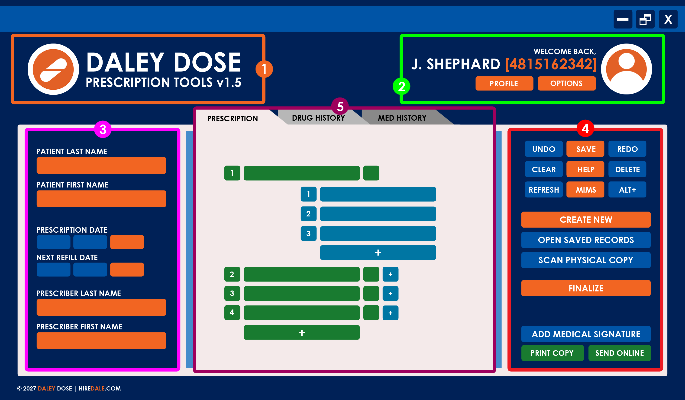
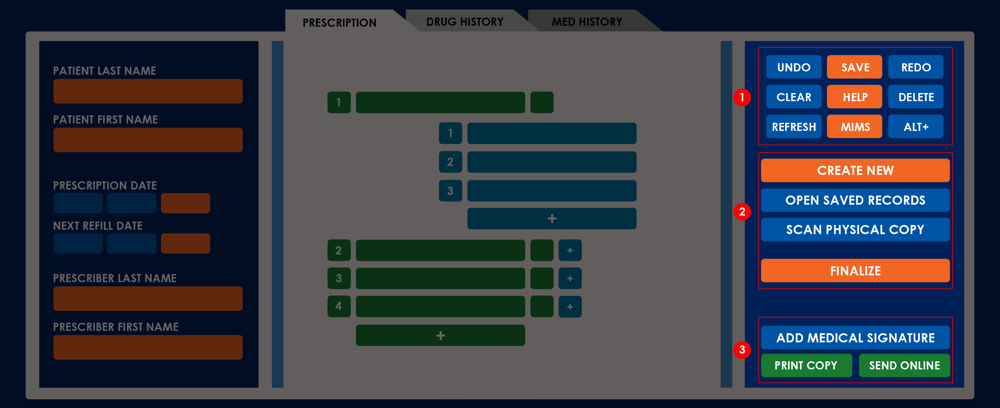
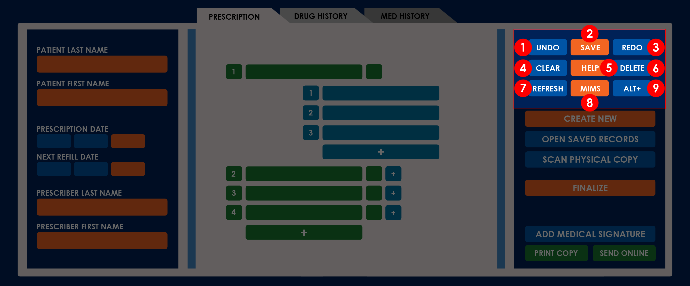
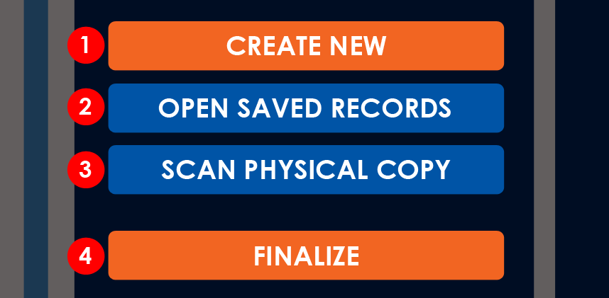
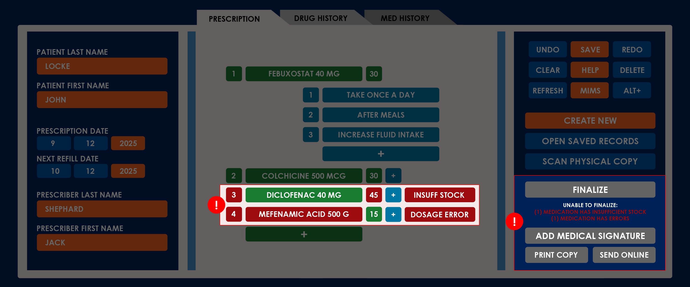
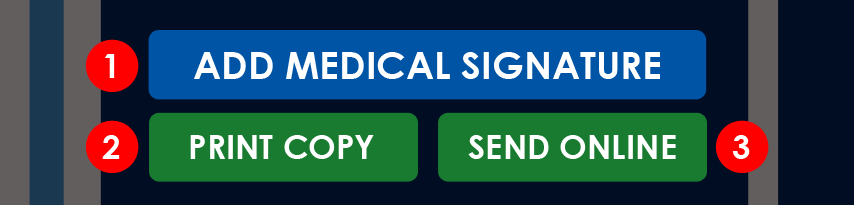
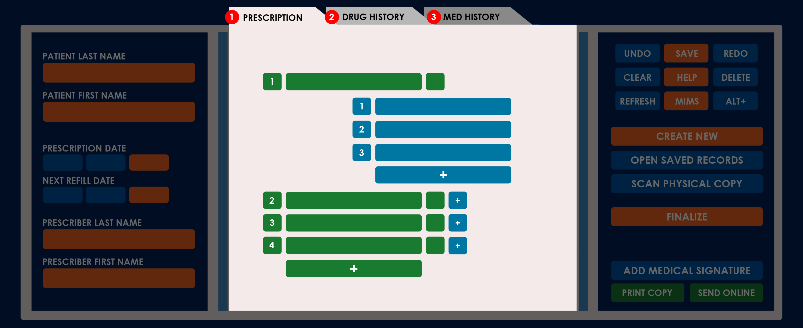

# **PHARMACY WINDOW**
---

In the **Pharmacy** window, you can create medical prescriptions for your patients. Each prescription can include up to 5 medications. You can also scan physical prescriptions and convert them into a digital version.

- To create a new prescription, click **Create New** in the **Action Sidebar**.
- To open a previously saved prescription drafts, click **Open Saved Records**.
- By default, after logging into the application, the **Home** window loads the last saved instance of a previous prescription draft (if any), enabling you to continue where you left off. You can disable this feature in the options.

## **NOTES**
---
- Access to the **Daley Dose** application requires an active subscription.  
- Your device must be connected to the internet to send digital prescriptions.

## **INTERFACE DETAILS**
---

The **Home** window is composed of the **Title Section**, **Profile Section**, **Information Sidebar**, **Action Sidebar**, and **Work Area**.  

Most of the interface remains the same throughout the prescription‑making process. Only the middle section, referred to as the **Work Area**, changes depending on the current window or tab accessed.

  

The following table describes the fields in the **Information Sidebar**:

| # | **FIELDS** | **DEFINITION** |
|---|------------|----------------|
| 1 | **PATIENT LAST NAME** | Displays the patient’s last name. Select to enter or edit the current patient’s name.  **Notes:** • The application prevents adding medications and notes when the **Patient Name** fields are empty. • Entering a **Patient Last Name** restricts options for **Patient First Names** to those with an existing record in the database. |
| 2 | **PATIENT FIRST NAME** | Displays the patient’s first name. Select to enter or edit the current patient’s name. |
| 3 | **PRESCRIPTION DATE** | Displays the prescription’s issue date. Select to enter or edit the current prescription date.  **Note:** The application displays the date in [MM/DD/YYYY] format. |
| 4 | **NEXT REFILL DATE** | Displays the prescription’s scheduled refill date. Select to enter or edit the current scheduled refill date.  **Note:** The application displays the date in [MM/DD/YYYY] format. |
| 5 | **PRESCRIBER LAST NAME** | Displays the prescribing user’s last name.  **Note:** This is a read‑only field. The prescriber information is based on the current user logged into the application. |
| 6 | **PRESCRIBER FIRST NAME** | Displays the prescribing user’s first name.  **Note:** This is a read‑only field. The prescriber information is based on the current user logged into the application. |

## **ACTION SIDEBAR**
---
The **Action Sidebar** is located on the right side of the screen.  

It displays the buttons to create and manage prescriptions. These buttons are divided into three categories: **Utility**, **Main**, and **Generation**.

For simplicity, this guide presents the button definitions by category.

### **UTILITY**
---
The **Utility** buttons enable you to manage individual prescription entries and access in‑app references, including the help files and the latest *Monthly Index of Medical Specialities (MIMS)* edition.

The following table describes the **Utility** buttons in the **Action Sidebar**:

| # | **BUTTONS** | **DEFINITION** |
|---|-------------|----------------|
| 1 | **UNDO** | Click to undo the last action performed in the current prescription. |
| 2 | **SAVE** | Click to save the current prescription. The application automatically displays the saved prescription the next time you log in. You can view a list of saved prescriptions using the **Open** button.  **Note:** Saved prescriptions are removed from the system. |
| 3 | **REDO** | Click to redo the last action undone in the current prescription. |
| 4 | **CLEAR** | Click to clear the current prescription entry’s contents. |
| 5 | **HELP** | Click to access an in-app version of the latest **Daley Dose Help Files**.  **Notes:** • The help files automatically open the entry about the current window. • You can also view the latest version of the help files on the **Daley Dose** website. |
| 6 | **DELETE** | Click to open or close **Delete Mode**, which allows you to mark existing entries in the prescription for deletion.  **Note:** The application displays the confirmation message “**Are you sure you want to delete these from the prescription?**” before removing the selected entries from the list. |
| 7 | **REFRESH** | Click to refresh the contents of the current session to match any saved instances or records in the database. This includes the contents of the patient's **Drug History** and **Medical History** tabs. |
| 8 | **MIMS** | Click to access an in-app version of the latest *Monthly Index of Medical Specialities (MIMS)* digital handbook, the most common drug reference for healthcare professionals.  **Note:** The **MIMS** version is updated along with every **Daley Dose** version. |
| 9 | **ALT+** | Click to add an alternative option for the pharmacy if the prescribed medication is not available.  When you select this button, the application opens the [**Add Alternative** window](/daleydose/window-add-alternative).  **Note:** The application auto-completes generic and brand name suggestions for each medication. You can turn off this feature in the options. |

### **MAIN**
---
The **Main** buttons enable you to add, edit, or finalize prescriptions. The application disables the **Finalize** button if it detects an issue with any of the current prescription items.

The following table describes the **Main** buttons in the **Action Sidebar**:

| # | **BUTTONS** | **DEFINITION** |
|---|-------------|----------------|
| 1 | **CREATE NEW** | Click to create a new prescription.  When you select this button while there are items on the current prescription, the application displays the confirmation message “**Are you sure you want to erase the current prescription?**”  The application erases all populated fields when you select **Yes**. |
| 2 | **OPEN SAVED RECORDS** | Click to open and edit a previously saved prescription. |
| 3 | **SCAN PHYSICAL COPY** | Click to scan a handwritten prescription and create a digital version in a new prescription window.  When you select this button, the application opens the [**Scan** window](/daleydose/window-scan).  **Notes:** • The application displays this button on the desktop version only when your computer has a confirmed connected webcam. • The application always displays this button on the mobile app. |
| 4 | **FINALIZE** | Click to finalize the current prescription.  When you select this button, the application locks the contents of the current prescription and enables the **Add Medical Signature**, **Print Copy**, and **Send Online** buttons. |

### **GENERATION**
---
The **Generation** buttons enable you to sign, print, and send the current prescription. These buttons are locked by the system to prevent errors when issuing prescriptions.

To unlock the **Generation** buttons, you must first click the **Finalize** button.

The following table describes the **Generate** buttons in the **Action Sidebar**:

| # | **BUTTONS** | **DEFINITION** |
|---|-------------|----------------|
| 1 | **ADD MEDICAL SIGNATURE** | Click to add your official medical signature to the prescription.  This field is required to finalize the prescription.  **Note:** You must have a medical signature template saved in your profile to use this functionality. |
| 2 | **PRINT COPY** | Click to print the current prescription on a local printer.  **Notes:** • This option is available only on devices with a confirmed connection to a printer. • This feature is not available on the **Daley Dose** mobile app. |
| 3 | **SEND ONLINE** | Click to send the prescription to the **Daley Dose** database for deployment.  **Note:** The application displays the confirmation message “**Finalize and send out this prescription?**” before sending. |

## **WORK AREA**
---

The **Work Area** is where you create, review, and finalize prescriptions. It occupies the center of the screen and contains three tabs:

- [**Prescription**](/daleydose/window-prescription-tab) — Enables you to build a prescription by adding medications and notes.  
- [**Drug History**](/daleydose/window-drug-history-tab) — Displays the patient’s digitized prescription history from the past 20 years.  
- [**Med History**](/daleydose/window-med-history-tab) — Displays the patient’s digitized medical conditions and treatments from the past 20 years.

These tabs work together to provide a complete view of the patient’s treatment plan. You can learn more about each tab on their individual entries.

## **RELATED TOPICS**
---
- You must have a **Prescriber** role to create prescriptions. See [**User Roles**](/daleydose/about-user-roles) for more information.  
- An **Administrator** or **Support** user can impose or remove a prescription restriction on a **Prescriber**. See [**Prescription Restrictions**](/daleydose/about-prescription-restrictions) for more information.  

